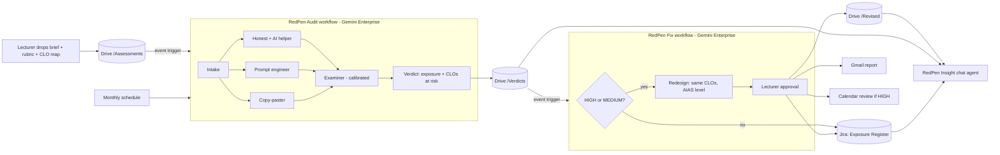

# RedPen: an AI red-team for university assessments

> **They catch students. We fix assignments.**
> Before your students try to get AI to do the assignment, RedPen already has, and it tells you which learning outcomes you can no longer trust.

**APU Cloud Innovation Hackathon 2026** · Theme 2: Intelligent Automation & Digital Transformation (with links to Theme 3)
**Team:** Hassan · Abdullah
**Built with:** Gemini Enterprise (workflow agents + chat agent), Google Drive, Gmail, Google Calendar, Jira Cloud, Google Antigravity

> 🚧 Draft, being filled in during the hackathon. Sections marked `[TODO]` are completed with our real pilot results before submission.

---

## 1. Problem
- Generative AI can now complete many university assignments at a passing grade.
- Lecturers only find out which assessments are exposed at **marking time**, which is too late.
- Worse, an assessment that AI can pass **no longer proves the course learning outcomes (CLOs)** it's mapped to.
  - MQA requires assessment to be aligned with learning outcomes, with CLOs mapped to programme learning outcomes (PLOs) (COPPA 2nd ed.).
  - APU's UK QAA accreditation is "subject to a satisfactory mid-cycle review", which APU says will take place by 2027.
  - So unreliable CLO evidence is a risk for the whole university, not just one lecturer.
- Redesigning assessments is manual and inconsistent, and it's never finished: every stronger model makes last semester's "safe" assessment unsafe again.

## 2. Solution
RedPen runs inside **Gemini Enterprise** as two workflow agents and a chat agent.

1. **RedPen Audit** (workflow). Triggered when a lecturer drops a brief into Drive, and re-run **monthly** on a schedule.
   - **Intake** reads the brief, rubric and CLO map.
   - **Three simulated students** attempt the highest-mark tasks: a *copy-paster*, a *prompt engineer*, and an *honest student using AI as allowed*.
   - An **Examiner** agent, calibrated against real lecturer marks, grades them on the real rubric.
   - The **Verdict** step outputs an **AI-Exposure level (HIGH / MEDIUM / LOW)** and the **CLOs no longer reliably evidenced**, then saves a verdict file to Drive.
2. **RedPen Fix** (workflow). Triggered by the new verdict file.
   - For HIGH or MEDIUM exposure, a **Redesign** agent proposes 2–3 redesigns that **still test the same CLOs**, each labelled with an AI Assessment Scale level and a two-lane position.
   - The **lecturer approves**. Then RedPen updates the **Jira exposure register**, saves the revised brief to Drive, emails the report, and books a review meeting if exposure is HIGH.
3. **RedPen Insight** (chat agent). Programme leaders ask "Which CLOs in my programme are at risk?" and get answers grounded in the Jira register and the Drive verdicts.

### Architecture

**Connectors:** Google Drive (event triggers, briefs, verdicts, revised briefs), Gmail, Google Calendar (first-party); **Jira Cloud** (third-party: create/update issues = the exposure register).

**How we used Antigravity:** see [`docs/antigravity/`](docs/antigravity/). `[TODO: summarise]`

## 3. Research
- **Assessment-design evidence:** the AI Assessment Scale (Perkins, Roe & Furze, 2025), the University of Sydney's two-lane approach (Semester 2 2025), the University of Bath's two-lane framework (from September 2026), and AUT's adaptation.
- **Malaysian context:** see the fact-check table in [`IDEA.md`](IDEA.md) §10. We only use each claim at the strength the source supports.
- **Competition and positioning:** detection tools, including AI vivas, act *after* submission. RedPen acts *before* release, which is cheaper, less adversarial, and protects CLO evidence.
- **Interviews:** `[TODO: N APU lecturers interviewed, key findings, quote]`
- **Calibration:** `[TODO: "N of N within one grade band, mean difference X marks"]`; method in [`docs/calibration/`](docs/calibration/README.md).

## 4. Impact
- **Pilot on real APU briefs:** `[TODO: X of N passable by an unedited AI answer; Y CLOs across Z modules no longer reliably evidenced]`
- **Model drift:** `[TODO: e.g. "the same brief scored C with Flash and B+ with Pro"]`. This is why RedPen re-audits monthly.
- **Time:** `[TODO: minutes per RedPen audit vs a lecturer's estimate for a manual audit + redesign]`
- **Rollout:**
  - **3 months:** one programme's full assessment bank audited before the semester starts.
  - **6 months:** every programme, with monthly re-audit trends.
  - The goal is fewer academic-misconduct cases and stronger evidence for the QAA mid-cycle review.
- **Beyond APU:** every university faces this. RedPen is a reusable education agent.

**Responsible use:** RedPen never sees student submissions or student data. A lecturer approves every change. Verdicts are a risk signal from simulated attempts, not an accusation against any student.

## 5. Teamwork
| | Hassan | Abdullah |
|---|---|---|
| Built | Fix workflow (Redesign, approval, Jira/Drive/Gmail/Calendar actions), Jira Cloud + connector | Audit workflow (Intake, 3 personas, Examiner, Verdict, triggers, Flash vs Pro), Insight chat agent |
| Evidence | Pilot on real briefs, statistics, lecturer interviews | Examiner calibration |
| Presentation | Pitch deck, README | Demo video, architecture diagram, judge access |

We built in parallel. The two workflows only meet at one shared contract, the [verdict file format](agents/verdict-format.md), and we joined our parts at 4 sync points ([`TASKS.md`](TASKS.md)).
**Time spent:** `[TODO]`

---

## Repository map
| Path | What's inside |
|---|---|
| [`IDEA.md`](IDEA.md) | Full concept, workflow, risks, fact-check |
| [`TASKS.md`](TASKS.md) | Work split, sync points, day-by-day plan |
| [`agents/verdict-format.md`](agents/verdict-format.md) | The hand-off contract between the two workflows |
| [`agents/audit/`](agents/audit/) | Audit workflow: build guide + instructions for every agent + chat agent |
| [`agents/fix/`](agents/fix/) | Fix workflow + Jira: build guide, Redesign agent, approval and action templates |
| [`data/sample-assessments/`](data/sample-assessments/) | 5 synthetic test assessments (brief, rubric, CLO map) |
| [`data/fake-verdicts/`](data/fake-verdicts/) | Example verdict files (HIGH, LOW) |
| [`data/policy/`](data/policy/) | Assessment-design knowledge for the Redesign and chat agents |
| [`data/calibration/`](data/calibration/), [`data/pilot/`](data/pilot/) | Templates for our evidence |
| [`docs/`](docs/) | Day-1 checklist, demo script, judge access, Antigravity log, outreach, bugs |
| [`deck/`](deck/) | Pitch deck outline and final PDF |

## Try it
See [`docs/judge-access.md`](docs/judge-access.md). Demo video: `[TODO: link]`
