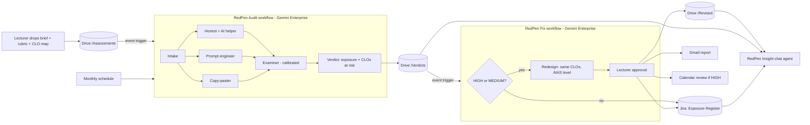

# RedPen: an AI red-team for university assessments

> **They catch students. We fix assignments.**
> Before your students try to get AI to do the assignment, RedPen already has, and it tells you which learning outcomes you can no longer trust.

**APU Cloud Innovation Hackathon 2026** · Theme 2: Intelligent Automation & Digital Transformation (with links to Theme 3)
**Team:** Hassan · Abdullah
**Prototype (13 Nov):** Streamlit app running our agent prompts on Google Gemini (Flash and Pro). On approval it acts for real: a **Jira Cloud** card, a **Gmail** report and a **Google Calendar invitation**. A **monthly scheduled re-audit** (GitHub Actions) re-runs the red team with no one pressing a button. **Final build (17 Nov):** the same prompts as Gemini Enterprise workflow agents + a chat agent, with Drive, Gmail, Calendar and Jira connectors. Google Antigravity used in development (see below).

**Try it:** **[https://redpen-apu.streamlit.app](https://redpen-apu.streamlit.app)** (hosted), or run `streamlit run streamlit_app.py` (see [Try it](#try-it)). Architecture: [`docs/architecture.png`](docs/architecture.png).

---

## 1. Problem
- Generative AI can now complete many university assignments at a passing grade.
- Lecturers only find out which assessments are exposed at **marking time**, which is too late.
- Worse, an assessment that AI can pass **no longer proves the course learning outcomes (CLOs)** it's mapped to.
  - MQA requires assessment to be aligned with learning outcomes, with CLOs mapped to programme learning outcomes (PLOs) (COPPA 2nd ed.).
  - APU's UK QAA accreditation is "subject to a satisfactory mid-cycle review", which APU says will take place by 2027.
  - So unreliable CLO evidence is a risk for the whole university, not just one lecturer.
- Redesigning assessments is manual and inconsistent, and it's never finished: every stronger model makes last semester's "safe" assessment unsafe again.

## 2. Solution
RedPen is designed as two **Gemini Enterprise** workflow agents and a chat agent. The prototype app runs the same agent instructions on the Gemini API today.

1. **RedPen Audit** (workflow). Triggered when a lecturer drops a brief into Drive, and re-run **monthly** on a schedule.
   - **Intake** reads the brief, rubric and CLO map.
   - **Three simulated students** attempt the highest-mark tasks: a *copy-paster*, a *prompt engineer*, and an *honest student using AI as allowed*.
   - An **Examiner** agent grades them on the real rubric, like a lecturer with no AI detector (calibrated, see Research).
   - The **Verdict** step outputs an **AI-Exposure level (HIGH / MEDIUM / LOW)** and the **CLOs no longer reliably evidenced**, then saves a verdict file to Drive.
2. **RedPen Fix** (workflow). Triggered by the new verdict file.
   - For HIGH or MEDIUM exposure, a **Redesign** agent proposes 2–3 redesigns that **still test the same CLOs**, each labelled with an AI Assessment Scale level and a two-lane position.
   - The **lecturer approves**. Then RedPen updates the **Jira exposure register**, saves the revised brief to Drive, emails the report, and books a review meeting if exposure is HIGH.
3. **RedPen Insight** (chat agent). Programme leaders ask "Which CLOs in my programme are at risk?" and get answers grounded in the Jira register and the Drive verdicts.

### Architecture


**Connectors:** Google Drive (event triggers, briefs, verdicts, revised briefs), Gmail, Google Calendar (first-party); **Jira Cloud** (third-party: create/update issues = the exposure register).

**Ready for Gemini Enterprise, not ported later:** the prototype runs the exact agent instructions that go into the workflows. [`agents/gemini-enterprise/`](agents/gemini-enterprise/README.md) holds a paste sheet generated from those files, a JSON schema per step, the Drive folder tree to upload, and a checker for every Gemini Enterprise run. We also tested the platform's worst case (a step that can only see the previous step's output) live: verdicts stay valid. 43 automated tests guard all of it (`python3 tools/test_engine.py`).

**How we used Antigravity:** we opened the repo in Google Antigravity and its agent (1) explained how the app, audit engine and fix module fit together, (2) built the register's **Download CSV** button now in the app, and (3) wrote and ran a unit test for the Google Calendar link. Prompts, screenshots and results: [`docs/antigravity/`](docs/antigravity/).

## 3. Research
- **Assessment-design evidence:** the AI Assessment Scale (Perkins, Roe & Furze, 2025), the University of Sydney's two-lane approach (Semester 2 2025), the University of Bath's two-lane framework (from September 2026), and AUT's adaptation.
- **Malaysian context:** see the fact-check table in [`IDEA.md`](IDEA.md) §10. We only use each claim at the strength the source supports.
- **Competition and positioning:** detection tools, including AI vivas, act *after* submission. RedPen acts *before* release, which is cheaper, less adversarial, and protects CLO evidence.
- **Calibration ("isn't this just AI grading AI?"):** 7 real APU assignments (5 modules, used with the student's permission) were marked by an independent AI marker from a different model family **before** any Gemini run. Our Gemini Examiner then marked the same 7: **7 of 7 within one grade band, 5 of 7 the same grade, mean gap 4.4 percentage points.** These are cross-model reference marks, not lecturer marks; we say so.
  - Calibration also found and fixed two real Examiner flaws: it was too generous (+16 points, round 1), and it gave marks for a face-to-face viva that never happened. A `live_session` flag now gives those criteria 0. Rounds and numbers: [`docs/calibration/results.md`](docs/calibration/results.md).

## 4. Impact
- **Pilot on 4 real APU briefs** (Level 2, Semester 2 2026): **2 of 4 were passed by an unedited copy-paste of the brief into Gemini** (Concurrent Programming: A, 77%; Data Structures Lab 1: C, 50% at a 50% pass mark), and a third (Data Structures Lab 2) was passed with an A+ on its written part by a student using AI strategically. **4 CLOs across 2 modules are no longer reliably evidenced.** The one LOW result (Web Applications) is LOW because half its marks come from a live demonstration, which is exactly the kind of redesign RedPen recommends. Runs: [`data/pilot-real/`](data/pilot-real/).
- **The model matters:** the same 4 briefs audited end to end on Gemini Pro gave a different verdict on 2 of 4 (Concurrent Programming HIGH → MEDIUM, Data Structures Lab 2 MEDIUM → LOW; Pro's examiner marks more strictly). So every verdict records its model, and RedPen re-audits monthly. Runs: [`data/pilot-real/runs/`](data/pilot-real/runs/).
- **Time:** one full audit (6 agent steps) takes **under a minute on Gemini Flash** and 3–6 minutes on Pro; the redesign adds one more call.
- **Rollout:**
  - **3 months:** one programme's full assessment bank audited before the semester starts.
  - **6 months:** every programme, with monthly re-audit trends.
  - The goal is fewer academic-misconduct cases and stronger evidence for the QAA mid-cycle review.
- **Beyond APU:** every university faces this. RedPen is a reusable education agent.

**Limits we're honest about:** a single audit can move one exposure level between runs (Concurrent Programming came out HIGH in one run and MEDIUM in another), so RedPen records the model and date on every verdict, and a decision that matters should rest on two runs. Calibration reference marks come from an independent AI marker, not lecturers; lecturer-marked calibration is the first step of the 3-month rollout.

**Responsible use:** RedPen never sees student submissions or student data. A lecturer approves every change. Verdicts are a risk signal from simulated attempts, not an accusation against any student.

## 5. Teamwork
| | Hassan | Abdullah |
|---|---|---|
| Built | Fix workflow (Redesign, approval, Jira/Drive/Gmail/Calendar actions), Jira Cloud + connector | Audit workflow (Intake, 3 personas, Examiner, Verdict, triggers, Flash vs Pro), Insight chat agent |
| Evidence | Pilot on real briefs, statistics, lecturer interviews | Examiner calibration |
| Presentation | Pitch deck, README | Demo video, architecture diagram, judge access |

We built in parallel. The two workflows only meet at one shared contract, the [verdict file format](agents/verdict-format.md), and we joined our parts at 4 sync points ([`TASKS.md`](TASKS.md)).
**Time spent:** shared equally between Hassan and Abdullah, 5–13 Nov 2026.

---

## Repository map
| Path | What's inside |
|---|---|
| [`IDEA.md`](IDEA.md) | Full concept, workflow, risks, fact-check |
| [`TASKS.md`](TASKS.md) | Work split, sync points, day-by-day plan |
| [`agents/verdict-format.md`](agents/verdict-format.md) | The hand-off contract between the two workflows |
| [`agents/audit/`](agents/audit/) | Audit workflow: build guide + instructions for every agent + chat agent |
| [`agents/fix/`](agents/fix/) | Fix workflow + Jira: build guide, Redesign agent, approval and action templates |
| [`data/sample-assessments/`](data/sample-assessments/) | 5 synthetic test assessments (brief, rubric, CLO map) |
| [`data/fake-verdicts/`](data/fake-verdicts/) | Example verdict files (HIGH, LOW) |
| [`data/policy/`](data/policy/) | Assessment-design knowledge for the Redesign and chat agents |
| [`streamlit_app.py`](streamlit_app.py), [`tools/`](tools/) | Prototype app, audit engine (`redpen_audit.py`), fix actions (`redpen_fix.py`), calibration (`calibrate.py`), verdict checker |
| [`data/pilot-real/`](data/pilot-real/), [`data/demo-runs/`](data/demo-runs/) | Pilot on real APU briefs; saved audits for the app |
| [`data/calibration/`](data/calibration/) | Calibration results per round |
| [`docs/`](docs/) | Day-1 checklist, demo script, judge access, Antigravity log, outreach, bugs |
| [`deck/`](deck/) | Pitch deck outline and final PDF |

## Try it
```bash
pip install -r requirements.txt
echo "OPENROUTER_API_KEY=sk-or-..." > .env     # Gemini models via OpenRouter
streamlit run streamlit_app.py
```
- **Saved audits** (default) replay 9 full audits instantly, no key needed: 4 real APU briefs + 5 sample briefs, each with its redesign options.
- **Approve** (anyone can click it) opens an **outbox** showing every follow-up as the lecturer receives it: the report email on screen (+ `.eml` download), the review meeting with an **Add to Google Calendar** button (+ `.ics`), the revised brief and the verdict file.
- **Real Jira:** with the judge password (sidebar), Approve creates or updates a real card on our Jira Cloud board and the app reads it back live; the register at the bottom lists the board live from Jira.
- **Real email and calendar:** with the judge password, type **your own email** in the lecturer field and Approve: RedPen emails you the report and the revised brief through Gmail, and for HIGH exposure a calendar invitation (Yes / Maybe / No) that Gmail adds to your Google Calendar.
- **Monthly re-audit (scheduled):** [`.github/workflows/monthly-reaudit.yml`](.github/workflows/monthly-reaudit.yml) runs [`tools/reaudit.py`](tools/reaudit.py) at 09:00 MYT on the 1st of every month: it re-audits every real brief in the register on the current Gemini model, comments the result on each Jira card, and emails an alert if exposure went up. The app's **Monthly re-audit** panel shows the last run and what changed.
- **Run a new audit:** upload any brief + rubric (+ CLO map) as PDF, DOCX or TXT (judge password).
- Optional secrets: `APP_PASSWORD` (locks live runs), `JIRA_BASE_URL` / `JIRA_EMAIL` / `JIRA_API_TOKEN` (real Jira card on Approve), `SMTP_USER` / `SMTP_PASSWORD` (Gmail address + app password: real email with the revised brief and calendar invitation). Without them the app shows previews. Keys: [`docs/api-keys.md`](docs/api-keys.md).
- Command line: `python3 tools/redpen_audit.py <folder with brief.txt rubric.txt clo-map.txt>` (audit), `python3 tools/redpen_insight.py "<question>"` (RedPen Insight chat agent over the register), `python3 tools/calibrate.py <folder>` (calibration), `python3 tools/reaudit.py` (monthly re-audit), `python3 tools/test_engine.py` (43 offline tests).

Demo video: `[TODO: link]` · Hosted app: [https://redpen-apu.streamlit.app](https://redpen-apu.streamlit.app) · Judge access to Gemini Enterprise: [`docs/judge-access.md`](docs/judge-access.md)
